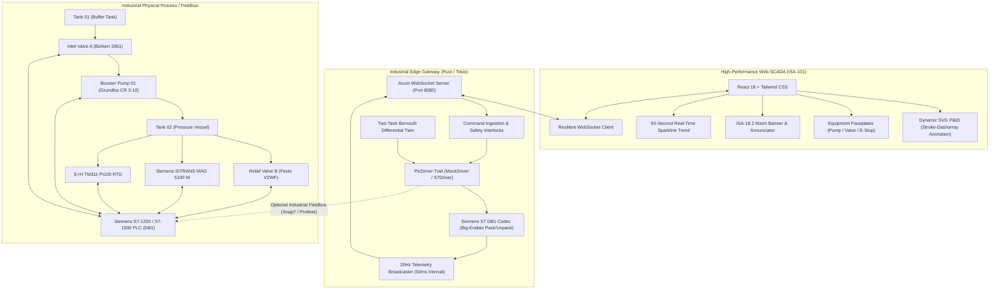
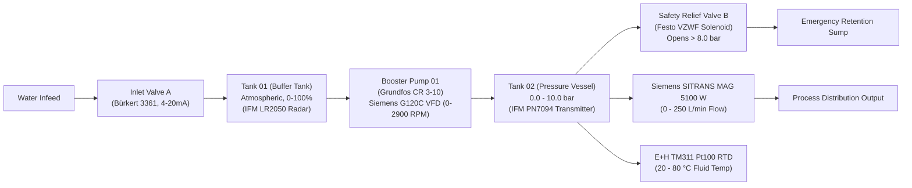

# HydroFlow SCADA

Industrial Fluid & Pressure Digital Twin with Hardware-in-the-Loop (HIL) Simulation, Siemens S7 PLC DB1 Binary Codec, 20Hz Telemetry Stream, and ISA-101 / ISA-18.2 High-Performance Web HMI.

---

## Architecture Overview



---

## Two-Tank Process Flow (P&ID)



---

## Siemens S7 PLC Memory Map (Data Block 1: DB1)

The system adheres strictly to the industrial Siemens Step 7 Big-Endian memory layout:

| Byte Offset | Tag Name | Type | Direction | Engineering Range | Instrument & Description |
| :--- | :--- | :--- | :--- | :--- | :--- |
| `0.0` | `PV_Tank1_Level` | `REAL` | PLC &rarr; SCADA | `0.0 - 100.0 %` | IFM LR2050 Radar Level Sensor (4-20mA) |
| `4.0` | `PV_Line_Pressure` | `REAL` | PLC &rarr; SCADA | `0.0 - 10.0 bar` | IFM PN7094 Piezoresistive Pressure Transmitter |
| `8.0` | `PV_Flow_Rate` | `REAL` | PLC &rarr; SCADA | `0.0 - 250.0 L/min` | Siemens SITRANS MAG 5100 W Electromagnetic Flowmeter |
| `12.0` | `PV_Pump_Current` | `REAL` | PLC &rarr; SCADA | `0.0 - 15.0 A` | Siemens G120C VFD Current Feedback |
| `16.0` | `PV_Fluid_Temp` | `REAL` | PLC &rarr; SCADA | `20.0 - 80.0 °C` | Endress+Hauser TM311 RTD Pt100 Temperature Sensor |
| `20.0` | `CMD_Pump_Start` | `BOOL` | SCADA &rarr; PLC | `0` or `1` | Command Bit: Start Booster Pump 01 |
| `20.1` | `CMD_Pump_Stop` | `BOOL` | SCADA &rarr; PLC | `0` or `1` | Command Bit: Stop Booster Pump 01 |
| `20.2` | `CMD_Relief_Open` | `BOOL` | SCADA &rarr; PLC | `0` or `1` | Command Bit: Open Emergency Relief Valve B |
| `22.0` | `SP_Pump_Speed` | `REAL` | SCADA &rarr; PLC | `0.0 - 100.0 %` | Setpoint: Target Pump Speed (0 - 2900 RPM) |
| `26.0` | `SP_ValveA_Pos` | `REAL` | SCADA &rarr; PLC | `0.0 - 100.0 %` | Setpoint: Inlet Valve A Modulating Position |

Total Packed Size: **30 Bytes** (`DB1Raw` with 2-byte word padding between byte `20` and byte `22` per Siemens S7 memory alignment rules).

---

## 1. Tutorial: 60-Second Quick Start

### Prerequisites
- [Docker](https://docs.docker.com/get-docker/) & Docker Compose installed.
- Modern browser (Chrome, Edge, Firefox, Safari).

### Launching the Stack

Clone the repository and launch both services with a single command:

```bash
# Clone the repository
git clone https://github.com/50kthaipat/HydroPro.git
cd HydroPro

# Start SCADA stack in Digital Twin Simulation mode
docker compose up -d --build
```

### Accessing the System
- **SCADA Web HMI**: Open [http://localhost:3000](http://localhost:3000)
- **Telemetry WebSocket**: `ws://localhost:8080/ws/telemetry`
- **Health Endpoint**: `http://localhost:8080/healthz`

---

## 2. How-To Guides

### How to Run in Development Mode
If developing without Docker:

```bash
# Terminal 1: Start Rust Simulation Backend
cd backend-rust
cargo run --release

# Terminal 2: Start Vite SCADA HMI
cd frontend-scada
npm install
npm run dev
```

### How to Issue SCADA Commands via WebSocket
Clients send JSON frames over the WebSocket connection (`ws://localhost:8080/ws/telemetry`):

**Start Pump Command:**
```json
{
  "type": "action",
  "command_id": "cmd-1001",
  "timestamp_ms": 1700000000000,
  "action": "start_pump"
}
```

**Set Flow Rate Setpoint:**
```json
{
  "type": "setpoint",
  "command_id": "cmd-1002",
  "timestamp_ms": 1700000000050,
  "target": "flow_rate",
  "value": 145.5
}
```

**Toggle Automatic Control Mode:**
```json
{
  "type": "mode",
  "command_id": "cmd-1003",
  "timestamp_ms": 1700000000100,
  "auto_mode": true
}
```

### How to Simulate Emergency Trips & Leaks
1. In the Web SCADA interface, open the **Simulation Drawer**.
2. Slide the **Leak Injection** slider to simulate pipe burst or discharge leakage.
3. Observe Tank 02 pressure climbing past **8.0 bar**.
4. The **ISA-18.2 Alarm Banner** flashes in high-priority red and the safety interlock trips Booster Pump 01 while cracking open Safety Relief Valve B.

---

## 3. Reference

### Telemetry Broadcast Frame Schema (20Hz)
Delivered every 50ms over WebSocket:

```json
{
  "seq": 14209,
  "timestamp_ms": 1729310400050,
  "flow_rate": 182.4,
  "pressure": 6.82,
  "tank_level": 74.2,
  "flow_setpoint": 180.0,
  "pressure_setpoint": 7.0,
  "total_flow": 1542.8,
  "heartbeat": 14209,
  "status": {
    "pump_running": true,
    "pump_fault": false,
    "valve_open": true,
    "valve_closed": false,
    "high_level_alarm": false,
    "low_level_alarm": false,
    "auto_mode": true,
    "emergency_stop": false
  }
}
```

### Project Directory Structure
```
HydroPro/
├── .github/
│   └── workflows/
│       └── ci.yml               # GitHub Actions CI (cargo clippy/test + npm build)
├── backend-rust/                # Industrial Edge Backend in Rust
│   ├── Cargo.toml               # Tokio, Axum, Serde, Futures dependencies
│   ├── src/
│   │   ├── broadcast.rs         # 20Hz non-blocking broadcast channel manager
│   │   ├── codec.rs             # Big-Endian DB1 pack/unpack byte encoder
│   │   ├── driver.rs            # PlcDriver trait & MockDriver implementation
│   │   ├── lib.rs               # Library root export
│   │   ├── messages.rs          # Strongly-typed WebSocket message contracts
│   │   ├── physics.rs           # Two-tank Bernoulli physics differential model
│   │   └── server.rs            # Axum WebSocket server & command dispatcher
│   └── tests/
│       └── codec_test.rs        # DB1 28-byte memory size & alignment unit tests
├── frontend-scada/              # ISA-101 / ISA-18.2 Web SCADA HMI
│   ├── src/
│   │   ├── components/
│   │   │   ├── AlarmBanner.tsx  # ISA-18.2 priority flashing alarm banner
│   │   │   ├── PidDiagram.tsx   # High-performance SVG P&ID diagram
│   │   │   └── TrendChart.tsx   # 60s sparkline real-time trend chart
│   │   ├── services/
│   │   │   └── websocket.ts     # Auto-reconnecting WebSocket client
│   │   ├── types/
│   │   │   └── scada.ts         # TypeScript interfaces for telemetry and commands
│   │   ├── App.tsx              # Main SCADA layout
│   │   └── main.tsx             # React DOM root
│   ├── package.json
│   ├── tailwind.config.js
│   └── vite.config.ts
├── Dockerfile.backend           # Multi-stage Rust build & minimal Debian runner
├── Dockerfile.frontend          # Multi-stage Node build & Nginx static server
├── docker-compose.yml           # Unified orchestration for ports 3000 & 8080
├── docs/
│   └── SPEC.md                  # Complete engineering specification
└── README.md                    # Diátaxis project documentation
```

---

## 4. Explanation

### ISA-101 High-Performance SCADA Philosophy
Traditional legacy SCADA HMIs suffer from sensory overload: colorful 3D pipes, spinning fans, and excessive neon lines distract operators from process deviations. 

HydroFlow SCADA follows the **ANSI/ISA-101.01-2015** standard:
- **Muted Grayscale Baseline**: Process pipes, tanks, pumps, and structural equipment are rendered in neutral slate/gray tones under normal steady-state operation.
- **Color Reserved for Anomalies**: High-contrast, standardized colors appear solely when attention is required (e.g., Red for critical emergency alarms, Amber for warning deviations).
- **Embedded Situation Awareness**: Real-time trend sparklines are situated directly alongside digital readouts so operators immediately perceive rate of change ($\frac{dP}{dt}$) rather than static numbers.
- **Dynamic P&ID Stroke Velocity**: Flow lines utilize animated SVG `stroke-dasharray` whose velocity correlates dynamically with `PV_Flow_Rate`.

### ISA-18.2 Alarm Management Lifecycle
Alarms adhere to **ANSI/ISA-18.2-2016** (Management of Alarm Systems for the Process Industries):
- **High-Pressure Alarm Threshold**: `PV_Line_Pressure > 8.0 bar`. Triggers unacknowledged audible/visual pulsing indicator (`animate-pulse bg-rose-600`).
- **Low-Level Alarm Threshold**: `PV_Tank1_Level < 10.0%`. Warns of pump cavitation risk.
- **Two-State Acknowledgment**: When operator clicks `ACKNOWLEDGE`, pulsing ceases and banner transitions to steady acknowledged state (`bg-rose-900`) until the physical variable returns to the normal operating envelope.

### Bernoulli Physics Twin Formulation
The digital twin solves fluid flow through the dual-tank system in discrete 50ms intervals using Torricelli's and Bernoulli's principles:

$$v = \sqrt{2g \Delta h + \frac{2\Delta P}{\rho}}$$

$$Q = C_d \cdot A \cdot v$$

1. **Tank 1 (Buffer)**: Experiences inlet flow modulated by Bürkert Valve A position and outlet flow governed by Grundfos booster pump speed.
2. **Booster Pump Head Curve**: Non-linear head generation characterized by centrifugal pump quadratic curve:
   $$\Delta H_{pump} = H_{shutoff} - k \cdot Q^2$$
3. **Tank 2 (Vessel Pressure Dynamics)**: Fluid accumulation and trapped gas compression follow the ideal gas law:
   $$P \cdot V = n R T \implies \frac{dP}{dt} = \frac{\gamma P}{V_{gas}} \left( Q_{in} - Q_{out} \right)$$
4. **First-Order Sensor Lag**: Sensor readings simulate physical transmitter response damping using a first-order low-pass filter:
   $$y[k] = \alpha \cdot x[k] + (1 - \alpha) \cdot y[k-1]$$

### Concurrency & Deadlock-Free Guarantee
The backend is architected on Tokio's multi-threaded asynchronous runtime:
- **Lock Hierarchy**: Only a single shared state mutex exists in `MockDriver`.
- **Zero Lock-Holding Across `.await`**: All lock acquisitions are strictly confined to synchronous memory manipulations; no async yield occurs while holding state.
- **Actor-Isolated WebSocket Tasks**: Each client connection spawns isolated `send_task` and `recv_task` workers joined via `tokio::select!`. If either half encounters an error or network reset, both halves gracefully abort without leaking tasks or memory.

---

## License
MIT License. Industrial SCADA & Digital Twin Simulation Engine.
